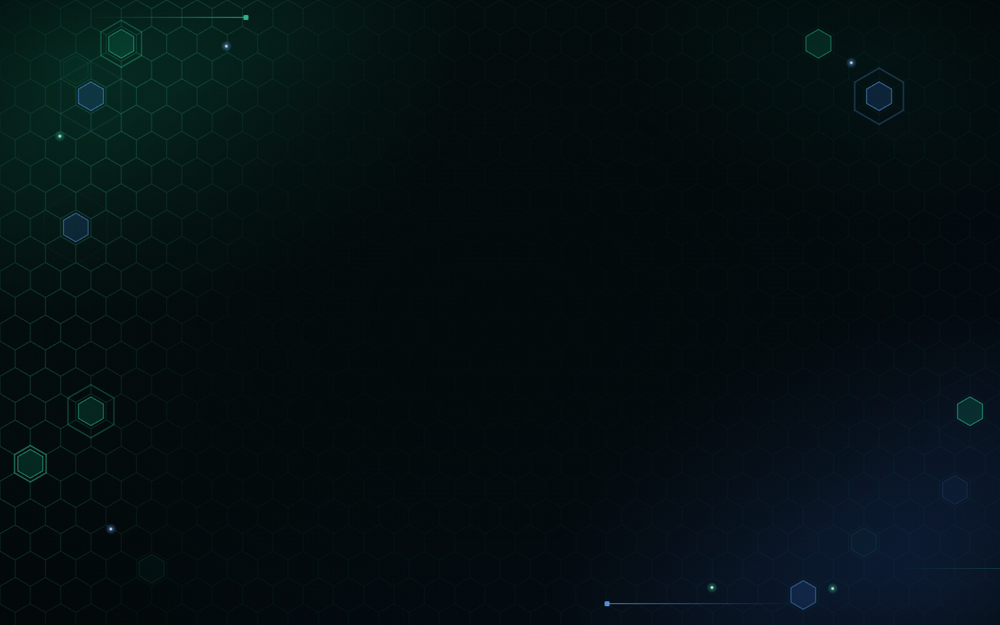

# Hive Night

A free theme for the Claude desktop app. It puts a dark hexagon floor behind the chat, with slow emerald and blue glows, cells that light up as if they're working, a few glowing bees and the odd comet. The chat sits on frosted glass above it.



## Install

At the prompt of a Claude Code session in the desktop app:

```
/plugin install hive-night --marketplace Errr0rr404/hive-night
```

Answer `y` to add the marketplace, then pick a scope.

From a shell:

```bash
claude plugin install hive-night --marketplace Errr0rr404/hive-night
```

The theme turns on when a session starts.

## Use

- `/hive-theme off` turns the backdrop off.
- `/hive-theme on` turns it back on.

## Notes

- You need a version of the Claude desktop app that draws mod backdrops. The terminal doesn't draw it.
- Everything is one animated SVG: no scripts, no network, no assets to download.
- If your system asks for reduced motion, the animation stops and the bees hide.
- Make it yours by changing the colors and the cell list in `hooks/scene.ts`.

## License

MIT, free to use and change. Made by [Zan](https://github.com/Errr0rr404).
